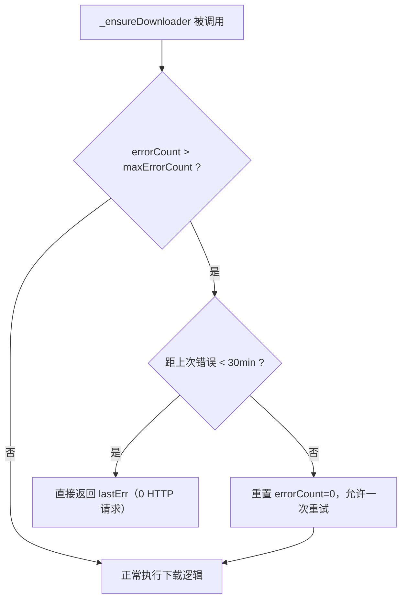
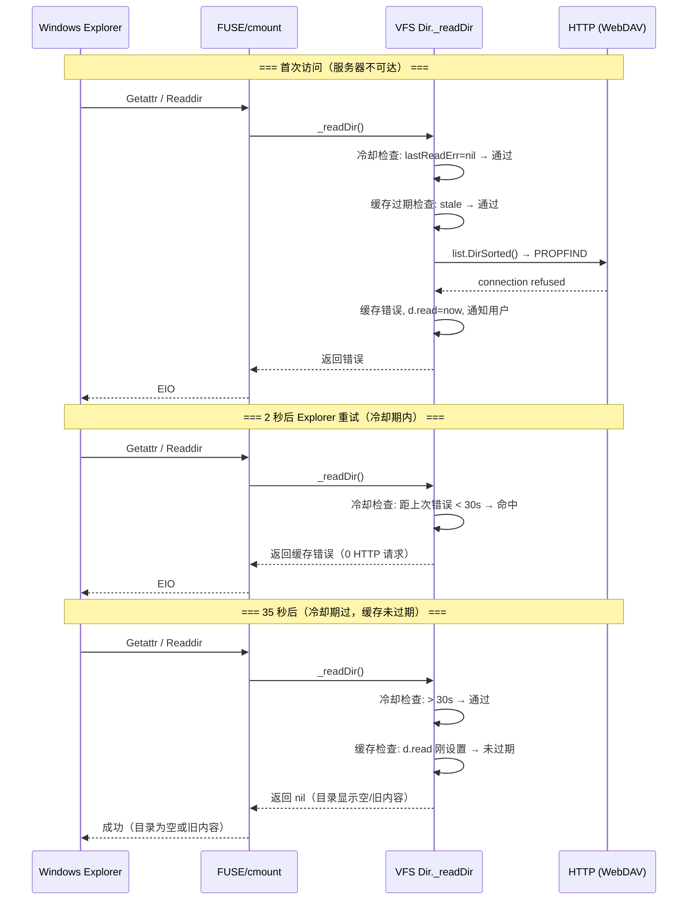
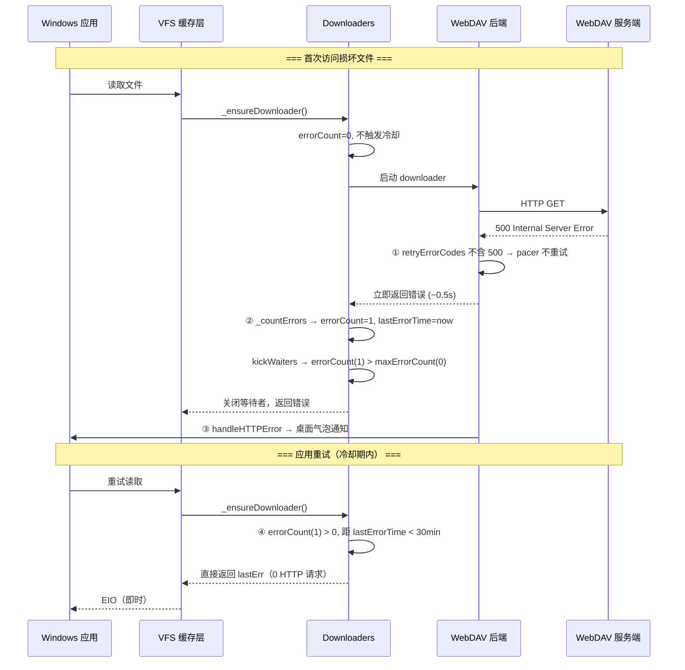

# rclone 错误处理与桌面通知增强 — 规格文档

## 1. 概述

### 1.1 背景

rclone 在挂载模式下存在以下两类用户体验问题：

**问题一：WebDAV 错误无感知**
当 WebDAV 服务端返回 HTTP 错误（403 权限拒绝、423 文件锁定、500 服务器内部错误、507 空间不足等）时，用户仅能在终端日志中看到错误信息，缺乏主动提醒手段。

**问题二：损坏文件导致无限重试死循环**
当 WebDAV 服务端存在永久性损坏的文件（如底层存储块损坏，返回 HTTP 500 + `Download block XXXX failed`）时，`--vfs-cache-mode full` 缓存层会陷入无限重试循环，导致挂载盘长时间无响应。详细机制：

1. Windows 应用访问损坏文件 → VFS 缓存层创建 `Downloaders` 尝试下载
2. HTTP 500 被 WebDAV 后端视为可重试错误，pacer 重试 3 次（指数退避 ~3-5s）
3. VFS 层有独立的 `lowLevelRetries`（默认 10 次），每次重试触发新的 WebDAV Open
4. 缓存下载器 `maxErrorCount = 10`，超过后关闭等待者，但 `Downloaders` 对象不销毁
5. 应用收到 EIO 后持续重试 → 重新触发步骤 2-4
6. 形成 `触发 → 失败 → 中止 → 再触发` 的死循环，挂载盘长时间无响应

**问题三：VFS 缓存上传失败无通知**
VFS cache 模式下文件上传失败（如网络超时、服务端不可达）时，仅有终端日志记录，用户完全无感知。

**问题四：后端不可达导致目录列表无限重试**
当 WebDAV 服务端不可达（如 TCP connection refused）时，Windows 资源管理器反复请求目录列表，每次请求触发新的 HTTP PROPFIND 调用，形成"Explorer 请求 → HTTP 失败 → Explorer 再请求"的无限循环，导致：

1. 每个目录请求经 pacer 重试（默认 3 次），但 VFS 层的 `_readDir()` 失败后不更新缓存时间
2. Explorer 每次重试都会进入 `_readDir()` → `list.DirSorted()` → WebDAV PROPFIND 的完整调用链
3. 即使用户设置 `--retries 1 --low-level-retries 1`，Explorer 层面的无限重试仍然导致持续 HTTP 请求
4. 资源管理器界面长时间冻结（卡死），用户体验极差

### 1.2 目标

1. WebDAV HTTP 错误时提供**桌面气泡通知**，让用户及时感知
2. 收到 HTTP 500 错误后**不重试**，直接返回失败
3. 损坏文件触发的缓存下载在**首次失败后停止**，冷却期内不再发起 HTTP 请求
4. 冷却期过后允许**一次重试**，以便临时性故障可自动恢复
5. VFS 缓存**上传失败时弹出桌面通知**，提醒用户注意
6. 目录列表失败时**缓存错误、弹出通知、冷却期内不发 HTTP 请求**，防止 Explorer 卡死

### 1.3 修改范围

| 文件 | 修改类型 | 说明 |
|------|----------|------|
| `lib/notify/notify.go` | **新增** | 跨平台桌面通知模块 |
| `fs/fs.go` | 修改 | 新增 `ErrorQuotaExceeded` sentinel error |
| `backend/webdav/webdav.go` | 修改 | 错误通知、移除 500 重试码、新增 500 通知分支 |
| `vfs/vfscache/writeback/writeback.go` | 修改 | VFS 缓存上传失败桌面通知 |
| `vfs/vfscache/downloaders/downloaders.go` | 修改 | 冷却机制、降低错误容忍度 |
| `vfs/dir.go` | 修改 | 目录列表错误缓存、冷却机制、桌面通知 |
| `go.mod` / `go.sum` | 修改 | 新增 beeep 依赖 |

---

## 2. 新增文件

### 2.1 `lib/notify/notify.go` — 桌面通知模块

**用途**: 提供跨平台桌面通知能力，封装 `github.com/gen2brain/beeep` 库。

**API**:

```go
// Send 发送普通桌面通知（没有声音）
func Send(title, message string)

// SendAlert 发送紧急桌面通知（带声音）
func SendAlert(title, message string)
```

**特性**:

| 特性 | 说明 |
|------|------|
| 容错 | 通知失败时静默处理（仅 DEBUG 日志记录），不影响主流程 |
| 跨平台 | Windows Toast/托盘气泡、Linux D-Bus/notify-send、macOS terminal-notifier → osascript 回退 |
| 零 CGO | 纯 Go 实现，静态编译进单一二进制文件 |
| AppName | `beeep.AppName = "网盘"`，通知来源显示为 "网盘" |
| 图标 | 内嵌 rclone logo（32x32 PNG，base64 编码），解码失败时回退空字符串 |
| 语言 | 通知标题和正文使用中文 |

**平台图标处理**:

| 平台 | 通知方式 | 图标处理 |
|------|----------|----------|
| macOS | terminal-notifier | PNG → ICNS 转换后显示 |
| macOS | osascript（回退） | 不使用图标 |
| Windows 10+ | Toast 通知 | 直接使用 PNG 路径 |
| Windows 7 | 托盘气泡 | PNG → ICO 转换后显示 |
| Linux | D-Bus | 解码为 RGBA 图像数据 |
| Linux | notify-send（回退） | 使用 PNG 文件路径 |

**依赖**: `github.com/gen2brain/beeep v0.11.2`

---

## 3. 修改文件

### 3.1 `fs/fs.go` — 新增 sentinel error

```go
ErrorQuotaExceeded = errors.New("storage quota exceeded")
```

用于 507 Insufficient Storage 错误的语义映射，调用方可据此判断是否为配额类错误。

---

### 3.2 `backend/webdav/webdav.go`

#### 3.2.1 新增配置选项

| 字段 | 类型 | 默认值 | 说明 |
|------|------|--------|------|
| `DesktopNotify` | `bool` | `true` | 启用/禁用桌面通知 |

```go
DesktopNotify bool `config:"desktop_notify"`
```

#### 3.2.2 从重试码中移除 500

**位置**: `var retryErrorCodes`

**修改前**:
```go
var retryErrorCodes = []int{
    423, // Locked
    425, // Too Early
    429, // Too Many Requests.
    500, // Internal Server Error
    502, // Bad Gateway
    503, // Service Unavailable
    504, // Gateway Timeout
    509, // Bandwidth Limit Exceeded
}
```

**修改后**:
```go
var retryErrorCodes = []int{
    423, // Locked
    425, // Too Early
    429, // Too Many Requests.
    502, // Bad Gateway
    503, // Service Unavailable
    504, // Gateway Timeout
    509, // Bandwidth Limit Exceeded
}
```

**设计理由**:

| 状态码 | 保留？ | 理由 |
|--------|--------|------|
| 502/503/504 | ✅ 保留 | 网关/负载均衡临时性问题，重试有恢复可能 |
| 500 | ❌ 移除 | 通常表示服务端永久性问题（如存储层损坏），重试无意义 |

移除后 `pacer.Call` 不再对 500 做退避重试，单次 HTTP 失败耗时从 ~3-5s 降至 ~0.5s。

#### 3.2.3 `handleHTTPError` — 错误通知方法

```go
func (f *Fs) handleHTTPError(ctx context.Context, err error, remote string, op string) error
```

**行为总览**:

| HTTP 状态码 | 终端输出 | 桌面通知 | 返回的错误 |
|-------------|----------|----------|-----------|
| 403 Forbidden | `fs.Errorf` (ERROR) | `SendAlert` (带声音) | `fs.ErrorPermissionDenied` |
| 423 Locked | `fs.Logf` (NOTICE) | `Send` (无声) | 原 `*api.Error` |
| 500 Internal Server Error | `fs.Errorf` (ERROR) | `SendAlert` (带声音) | 原 `*api.Error` |
| 507 Insufficient Storage | `fs.Errorf` (ERROR) | `SendAlert` (带声音) | `fs.ErrorQuotaExceeded` |
| 404 Not Found | `fs.Debugf` (DEBUG) | 无 | 原错误 |
| 其他 | `fs.Debugf` (DEBUG) | 无 | 原错误 |

桌面通知仅在 `f.opt.DesktopNotify == true` 时发送。

**通知标题与正文**:

| 状态码 | 通知标题 | 通知正文 |
|--------|----------|----------|
| 403 | "网盘 - 权限被拒绝" | `文件路径: 错误详情`（清洗后） |
| 423 | "网盘 - 文件被锁定" | `文件路径: 错误详情`（清洗后） |
| 500 | "网盘 - 服务器内部错误" | `文件路径: 错误详情`（清洗后） |
| 507 | "网盘 - 存储空间不足" | `文件路径: 错误详情`（清洗后） |

**消息提取逻辑**:

1. 优先使用 `apiErr.Message`（服务端返回的 `<s:message>` XML 元素）
2. 当 `apiErr.Message` 为空时，使用 `apiErr.Error()`（依次拼接 Message → Exception → Status）
3. 终端日志使用原始 `detailMsg`（保留完整调试信息）
4. 桌面通知使用 `sanitizeNotifyMsg()` 清洗后的文本

#### 3.2.4 `errorHandler` — 错误响应解析增强

**修改**: XML 解析成功但 `Message` 字段为空时，回退使用原始响应 body 作为 `Message`。

```go
// 新增回退逻辑
if errResponse.Message == "" {
    errResponse.Message = strings.TrimSpace(string(body))
}
```

**设计理由**: 无论 WebDAV 服务端使用何种错误响应格式（SabreDAV 的 `<s:message>`、纯文本、HTML、非标准 XML），`apiErr.Message` 始终包含服务端返回的信息。

#### 3.2.5 `sanitizeNotifyMsg` — 通知消息清洗

```go
func sanitizeNotifyMsg(raw string) string
```

**处理流程**:

| 步骤 | 操作 | 说明 |
|------|------|------|
| 1. 去除 XML/HTML 标签 | 正则 `<[^>]*>` 匹配并移除 | 避免 `<D:error>` 等出现在气泡中 |
| 2. 压缩空白字符 | `strings.Fields` + `strings.Join` | 换行/制表符 → 单个空格 |
| 3. URL 解码 | 优先 `url.PathUnescape`，回退 `url.QueryUnescape`，循环最多 3 次 | 处理 `%E5%8D%8F` → `协`、双重编码 |
| 4. 截断超长内容 | 超过 256 字符截断并追加 `...` | 适配 Windows 气泡最大长度 |
| 5. 空内容回退 | 返回 `"(无详细信息)"` | 确保通知始终有内容 |

**设计要点**:

- `url.PathUnescape` 优先：不会将 `+` 误当作空格（WebDAV 文件路径中 `+` 是合法字符）
- 循环解码：处理某些代理/中间件的二次编码（`%` → `%25`）
- 仅用于通知：终端日志保留原始 `detailMsg`

#### 3.2.6 修改的操作函数

以下函数增加了 `handleHTTPError` 调用：

| 函数 | 操作 | 新增行为 |
|------|------|----------|
| `readMetaDataForPath` | PROPFIND 读元数据 | 403 → PermissionDenied + 通知 |
| `listAll` | PROPFIND 列目录 | 403 → PermissionDenied + 通知 |
| `_mkdir` | MKCOL 创建目录 | 403 → PermissionDenied + 通知 |
| `mkdir` | 递归创建目录 | 403 → PermissionDenied + 通知 |
| `updateSimple` | PUT 上传文件 | 403/507 → 语义映射 + 通知 |
| `Remove` | DELETE 删除 | 403 → PermissionDenied + 通知 |
| `copyOrMove` | COPY/MOVE 复制移动 | 403 → PermissionDenied + 通知 |
| `DirMove` | MOVE 移动目录 | 403 → PermissionDenied + 通知 |
| `SetModTime` | PROPPATCH 修改时间 | 403 → PermissionDenied + 通知 |
| `purgeCheck` | DELETE 删除目录 | 403 → PermissionDenied + 通知 |

---

### 3.3 `vfs/vfscache/writeback/writeback.go` — 上传失败通知

#### 3.3.1 修改目标

VFS cache 上传失败时（如网络超时、服务端不可达），通过桌面气泡通知提醒用户。

#### 3.3.2 新增导入

```go
"github.com/rclone/rclone/lib/notify"
```

#### 3.3.3 修改方法: `upload`

在 `upload()` 方法中，当上传首次失败（`tries == 1`）时发送桌面通知：

```go
if errors.Is(err, context.Canceled) {
    fs.Infof(wbItem.name, "vfs cache: upload canceled")
    wbItem.delay = time.Duration(wb.opt.WriteBack)
} else {
    fs.Errorf(wbItem.name, "vfs cache: failed to upload try #%d, will retry in %v: %v",
        wbItem.tries, wbItem.delay, err)
    // Send desktop notification on first upload failure to alert the user
    if wbItem.tries == 1 {
        notify.SendAlert("上传失败", wbItem.name+": "+err.Error())
    }
}
```

#### 3.3.4 设计要点

| 项目 | 说明 |
|------|------|
| 通知时机 | 仅在首次失败（`tries == 1`）时发送，后续自动重试不再通知 |
| 通知类型 | `SendAlert`（带声音），与 WebDAV 403/500/507 错误级别一致 |
| 通知标题 | "上传失败" |
| 通知正文 | `文件名: 错误详情` |
| 无需配置 | 无条件发送，与终端 ERROR 日志行为一致，不引入额外开关 |
| 取消上传 | `context.Canceled` 时视为用户主动取消，不发送通知 |

---

### 3.4 `vfs/vfscache/downloaders/downloaders.go` — 错误冷却机制

#### 3.4.1 降低最大错误容忍度

**修改前**: `maxErrorCount = 10`
**修改后**: `maxErrorCount = 0`

**语义变化**:

- 修改前：容忍 10 次连续下载错误后才停止
- 修改后：**第一次错误即停止**（`errorCount` 从 0 变为 1，`1 > 0` 触发阈值）

#### 3.4.2 新增错误冷却期常量

```go
errorCooldownDuration = 30 * time.Minute
```

30 分钟足够覆盖一个工作时段，对永久性损坏文件等价于"不重试"；同时为临时性网络故障保留恢复可能。

#### 3.4.3 新增 `lastErrorTime` 字段

在 `Downloaders` 结构体中新增：

```go
lastErrorTime time.Time // time of last error
```

在 `_countErrors` 方法中记录：

```go
dls.lastErr = err
dls.lastErrorTime = time.Now()  // ← 新增
```

#### 3.4.4 `_ensureDownloader` 冷却检查

```go
if dls.errorCount > maxErrorCount {
    if time.Since(dls.lastErrorTime) < errorCooldownDuration {
        return dls.lastErr  // 冷却期内，0 HTTP 请求
    }
    fs.Infof(dls.src, "vfs cache: downloader: cooldown elapsed, resetting error count to 0")
    dls.errorCount = 0
    dls.lastErr = nil      // 冷却期过，允许一次重试
}
```

**逻辑流程**:



---

### 3.5 `vfs/dir.go` — 目录读取失败冷却 + 气泡通知

#### 3.5.1 修改目标

当后端不可达（TCP connection refused、DNS 解析失败等非 HTTP 错误）导致目录列表（PROPFIND）失败时：
- **首次失败弹出桌面气泡通知**，让用户知道挂载盘出了问题
- **30 秒冷却期内不发起新 HTTP 请求**，直接返回缓存错误
- **冷却期后将目录标记为"已读"**，Explorer 显示空或旧目录内容（不再报错）
- **DirCacheTime 过期后自动重试**，服务恢复后可自动恢复正常

#### 3.5.2 新增导入

```go
"github.com/rclone/rclone/lib/notify"
```

#### 3.5.3 Dir 结构体新增字段

```go
type Dir struct {
    // ... existing fields ...

    // Error caching: when a directory listing fails (e.g. server unreachable),
    // we cache the error to avoid repeated HTTP retries that freeze the mount.
    lastReadErr     error
    lastReadErrTime time.Time
}
```

#### 3.5.4 新增常量

```go
// dirErrorCooldown is how long to cache a directory listing error
// before allowing a retry. This prevents rapid repeated HTTP requests
// to a failing backend which can freeze the mount and block Explorer.
const dirErrorCooldown = 30 * time.Second
```

#### 3.5.5 修改方法: `_readDir`

**调用链**: 所有 FUSE 目录操作（`Getattr`、`Readdir`）最终都经过 `_readDir()`，因此在此处拦截可覆盖全部目录访问场景。

```go
func (d *Dir) _readDir() error {
    when := time.Now()

    // ① 冷却期检查：如果最近有错误且在冷却期内，直接返回缓存错误
    if d.lastReadErr != nil && time.Since(d.lastReadErrTime) < dirErrorCooldown {
        return d.lastReadErr
    }

    // ② 正常缓存过期检查
    if age, stale := d._age(when); !stale {
        return nil
    }

    // ③ 尝试列出目录
    entries, err := list.DirSorted(d.vfs.ctx, d.f, false, d.path)
    if err == fs.ErrorDirNotFound {
        // 目录不存在视为空
    } else if err != nil {
        // ④ 首次错误或冷却期已过→发送通知
        isFirstErr := d.lastReadErr == nil || time.Since(d.lastReadErrTime) >= dirErrorCooldown
        d.lastReadErr = err
        d.lastReadErrTime = time.Now()
        d.read = time.Now()  // ⑤ 标记目录为"已读"，阻止立即重试
        if isFirstErr {
            notify.SendAlert("网盘 - 目录读取失败", d.path+": "+err.Error())
        }
        return err
    }

    // ⑥ 成功 → 清除错误缓存
    d.lastReadErr = nil
    d.lastReadErrTime = time.Time{}
    // ... 后续正常处理 ...
}
```

#### 3.5.6 行为时序



#### 3.5.7 设计要点

| 项目 | 说明 |
|------|------|
| 拦截点 | `_readDir()` 是所有目录访问（`stat`、`ReadDirAll`、`isEmpty`）的唯一入口 |
| 冷却时长 | 30 秒——足够阻止 Explorer 的快速重试循环，又不会让用户等太久 |
| 错误标记为已读 | 失败时设置 `d.read = time.Now()`，让 VFS 缓存机制认为目录已读取，阻止立即重试 |
| 通知时机 | 仅在首次失败（或冷却期过后再次失败）时发送，避免消息轰炸 |
| 每个目录独立 | 每个 `Dir` 实例有独立的错误缓存，根目录和子目录各自冷却 |
| 自动恢复 | `DirCacheTime`（默认 5 分钟）过期后自动重试；若服务器恢复，`lastReadErr` 清零 |
| 无额外配置 | 通知和冷却均为内置行为，无需用户配置 |

---

## 4. 修改协同关系

三处修复（500 不去重试 + 缓存下载冷却 + 目录列表冷却）协同切断所有已知死循环路径：



---

## 5. 用户可见效果

### 5.1 终端输出

```
# --- WebDAV HTTP 错误 ---
# 403 权限拒绝
2026/06/12 10:00:00 ERROR : photo.jpg: 权限被拒绝 (403 Forbidden): ...
# 423 文件锁定
2026/06/12 10:00:01 NOTICE : photo.jpg: 文件被锁定 (423 Locked): ...
# 500 服务器内部错误
2026/07/10 10:30:01 ERROR : 我的空间/文件.docx: 服务器内部错误 (500): Download block XXXX failed. (op=GET)
# 507 空间不足
2026/06/12 10:00:02 ERROR : photo.jpg: 存储空间不足 (507 Insufficient Storage): ...

# --- 损坏文件：首次访问 ---
2026/07/10 10:30:01 INFO  : 文件.docx: vfs cache: downloader: error count now 1: ...
2026/07/10 10:30:01 ERROR : 文件.docx: vfs cache: too many errors 1/0: last error: ...
2026/07/10 10:30:01 ERROR : IO error: ...

# --- 损坏文件：冷却期内重试（30 分钟内） ---
2026/07/10 10:30:03 ERROR : IO error: ...
# 无 vfs cache 相关日志，0 HTTP 请求

# --- VFS 缓存上传失败 ---
2026/07/10 13:26:43 ERROR : 我的空间/test/rclone-windows-386.exe: Failed to copy: Put "...": timeout awaiting response headers
2026/07/10 13:26:43 ERROR : 我的空间/test/rclone-windows-386.exe: vfs cache: failed to upload try #1, will retry in 10s: ...

# --- 目录列表失败（首次，服务器不可达） ---
2026/07/10 14:08:45 ERROR : 我的空间/test/: Dir.Stat error: couldn't list files: Propfind "...": dial tcp 192.168.0.9:2020: connectex: No connection could be made because the target machine actively refused it.
2026/07/10 14:08:45 ERROR : IO error: couldn't list files: Propfind "...": dial tcp 192.168.0.9:2020: connectex: No connection could be made because the target machine actively refused it.
# → 同时弹出桌面气泡 "网盘 - 目录读取失败"

# --- 目录列表失败（冷却期内，2 秒后） ---
2026/07/10 14:08:47 ERROR : 我的空间/test/: Dir.Stat error: ... (来自缓存，0 HTTP 请求)
2026/07/10 14:08:47 ERROR : IO error: ... (来自缓存)

# --- 目录列表（冷却期过后，35 秒后） ---
# 无错误日志！目录显示为空或上次缓存的旧内容
```

### 5.2 桌面通知

| 场景 | 图标 | 通知内容 | 声音 |
|------|------|----------|------|
| 403 权限拒绝 | 🔴 | "网盘 - 权限被拒绝" / `文件路径: 错误详情` | 有 |
| 423 文件锁定 | 🔵 | "网盘 - 文件被锁定" / `文件路径: 错误详情` | 无 |
| 500 服务器错误 | 🔴 | "网盘 - 服务器内部错误" / `文件路径: 错误详情` | 有 |
| 507 空间不足 | 🔴 | "网盘 - 存储空间不足" / `文件路径: 错误详情` | 有 |
| VFS 上传失败 | 🔴 | "上传失败" / `文件名: 错误详情` | 有 |
| 目录读取失败 | 🔴 | "网盘 - 目录读取失败" / `目录路径: 错误详情` | 有 |

- 通知正文中的路径和错误详情均经过 `sanitizeNotifyMsg` 清洗（去除 XML 标签、URL 解码、截断至 256 字符）
- VFS 上传失败仅在首次失败时通知，后续自动重试（指数退避，最长 5 分钟间隔）不重复通知
- 目录读取失败仅在首次失败（或冷却期过后再次失败）时通知，30 秒冷却期内不发 HTTP 请求也不重复通知

### 5.3 挂载盘响应对比

| 场景 | 修改前 | 修改后 |
|------|--------|--------|
| 损坏文件首次被访问 | HTTP 重试 3 次 + VFS 重试 10 次 ≈ **30-50s 无响应** | 1 次 HTTP + 即时错误 ≈ **0.5s** |
| 损坏文件被反复访问 | 每 2s 发起新 HTTP 请求，持续刷日志 | **0 HTTP 请求**，即时返回错误 |
| 同目录下其他正常文件 | 可能受锁争用影响卡顿 | **不受影响** ✅ |
| 网络临时故障后恢复 | — | 30min 后允许一次重试，成功则 errorCount 清零 |
| 上传失败用户感知 | 仅日志，用户**无感知** | **桌面气泡通知** ✅ |
| 服务器不可达时 Explorer | 每 2 秒 HTTP 请求 → **界面卡死** | 首次通知后 30s 冷却 → **界面正常** ✅ |
| 服务器恢复后 | 需手动重启挂载 | **DirCacheTime 后自动恢复** ✅ |

---

## 6. 依赖

新增依赖 `github.com/gen2brain/beeep v0.11.2`，及其传递依赖：

```
github.com/gen2brain/beeep v0.11.2
├── git.sr.ht/~jackmordaunt/go-toast v1.1.2      (Windows Toast 通知)
│   ├── github.com/jackmordaunt/icns/v3 v3.0.1   (macOS ICNS 图标编码)
│   └── github.com/nfnt/resize v0.0.0-20180221191011-83c6a9932646  (图标缩放)
├── github.com/esiqveland/notify v0.13.3          (Linux D-Bus 通知)
│   └── github.com/godbus/dbus/v5 v5.1.0          (D-Bus 通信)
├── github.com/tadvi/systray v0.0.0-20190226123456-11a2b8fa57af  (Windows 7 托盘回退)
└── github.com/sergeymakinen/go-ico v1.0.0-beta.0 (ICO 图标编码)
    └── github.com/sergeymakinen/go-bmp v1.0.0    (BMP 格式编码)
```

> **注**：`golang.org/x/sys` 已在 `go.mod` 中存在（`v0.45.0`），并非本次新增。

所有依赖为 **纯 Go**，无 CGO 要求，静态编译进单一二进制文件。

---

## 7. 配置

### 7.1 WebDAV 桌面通知开关

在 `rclone config` 中配置 WebDAV 远端时，可通过 `desktop_notify` 选项控制：

```ini
[mywebdav]
type = webdav
url = https://example.com/webdav
vendor = nextcloud
desktop_notify = true   # 默认为 true，设为 false 关闭桌面通知
```

也可通过命令行覆盖：

```bash
rclone --config rclone.conf copy local: webdav: --webdav-desktop-notify=false
```

### 7.2 VFS 缓存上传通知

**无需额外配置**，上传失败时自动发送通知，与终端 ERROR 日志行为一致。

### 7.3 冷却机制

**无需额外配置**，各冷却期硬编码：

| 冷却项 | 时长 | 适用场景 |
|--------|------|----------|
| 缓存下载器错误冷却 | 30 分钟 | 损坏文件反复下载失败 |
| 目录列表错误冷却 | 30 秒 | 服务器不可达时的目录浏览 |

### 7.4 目录列表错误通知

**无需额外配置**，后端不可达时首次失败自动发送通知，与终端 ERROR 日志行为一致。

---

## 8. 影响范围

### 8.1 直接影响

- **WebDAV 后端**：HTTP 500 不再被 pacer 自动重试，影响所有使用 WebDAV 后端的操作（`mount`、`copy`、`sync` 等）
- **VFS 缓存下载器**：所有后端的损坏文件在下载失败 1 次后即停止（而非 10 次）
- **VFS 缓存写回**：上传失败时自动弹出桌面通知
- **VFS 目录缓存**：所有后端的目录列表失败后进入 30 秒错误冷却，影响 `mount` 模式下的目录浏览

### 8.2 不影响的场景

- HTTP 502/503/504：仍在 `retryErrorCodes` 中，pacer 继续重试
- `--vfs-cache-mode off/minimal/writes`：不经过缓存下载器，不受 downloaders.go 修改影响
- 非 WebDAV 后端（S3、SFTP 等）：不受 webdav.go 修改影响
- 超时类错误（context deadline exceeded 等）：通过 `fserrors.ShouldRetry(err)` 判断，不受影响
- VFS 上传成功：不发送通知，无干扰
- 目录列表成功：不经过错误缓存路径，无性能影响
- `--vfs-cache-mode off` 下的目录列表：同样受 `dir.go` 冷却保护（`_readDir` 是通用路径）

---

## 9. 回滚方案

若需回滚，按文件恢复以下变更：

| # | 文件 | 操作 |
|---|------|------|
| 1 | `webdav.go` | 加回 `500, // Internal Server Error`（恢复 pacer 对 500 的重试） |
| 2 | `webdav.go` | 删除 `case http.StatusInternalServerError:` 分支（移除 500 通知） |
| 3 | `webdav.go` | 删除 `handleHTTPError` 方法、`sanitizeNotifyMsg` 函数、`DesktopNotify` 字段及相关调用 |
| 4 | `downloaders.go` | `maxErrorCount = 10`（恢复 10 次容忍） |
| 5 | `downloaders.go` | 删除冷却机制相关代码（`lastErrorTime` 字段、`errorCooldownDuration` 常量、冷却检查逻辑） |
| 6 | `writeback.go` | 删除 `notify` 导入和 `notify.SendAlert` 调用 |
| 7 | `fs.go` | 删除 `ErrorQuotaExceeded` sentinel error |
| 8 | `lib/notify/notify.go` | 删除整个文件 |
| 9 | `go.mod` / `go.sum` | 移除 beeep 及其传递依赖 |
| 10 | `dir.go` | 删除 `lastReadErr`、`lastReadErrTime` 字段、`dirErrorCooldown` 常量、冷却检查逻辑、`notify` 导入和 `notify.SendAlert` 调用 |
